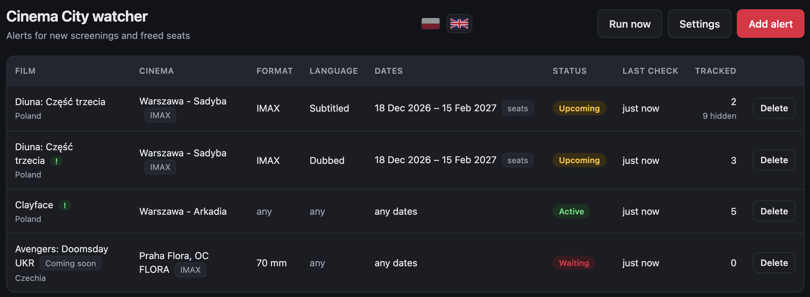
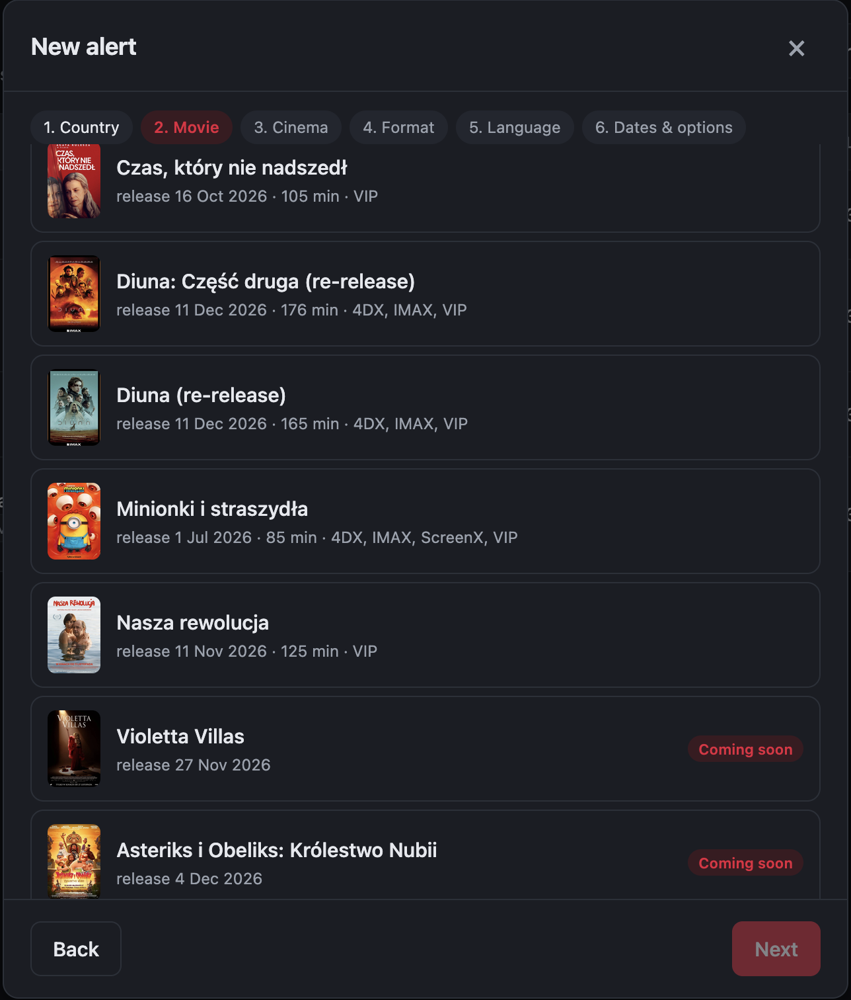
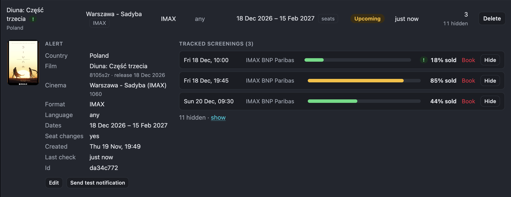

# cinema-city-watcher

Self-hosted watcher for Cinema City showtimes in Czechia and Poland. Pick a
film, a cinema and optionally a format, and get a push notification through
[ntfy](https://ntfy.sh) when new screenings go on sale or seats free up.



Python standard library only, no accounts, no cloud. Runs on anything that has
Python 3.9 or Docker.

## What it does

- **New screenings.** The moment a matching screening appears, you get a
  notification with a booking link. This is always on.
- **Coming soon.** Films that are announced but not on sale yet can be picked
  too. The alert waits for presale to open and then reports the first
  screenings.
- **Seats freed.** Optional per alert: for a sold-out screening on the date you
  want, be told when tickets come back.
- **Web UI** for managing alerts and settings, in English and Polish. A table of
  alerts, a step-by-step wizard, tracked screenings with how full they are.



## Quick start with Docker

```sh
git clone https://github.com/tymekPru/cinema-city-watcher.git
cd cinema-city-watcher
docker compose up -d --build
```

Open http://127.0.0.1:8080, set your ntfy topic under Settings, add an alert.

Two containers run from the same image: `watcher` sweeps every
`pollIntervalSeconds`, `ui` serves the web UI. Both mount `appsettings.json`
and `data/` from the repository folder, so settings and alerts live outside
the containers.

```sh
docker compose logs -f watcher   # sweeps and sent notifications
docker compose restart watcher   # after editing appsettings.json by hand
docker compose up -d --build     # update after git pull
```

## Without Docker

Python 3.9 or newer, nothing to install.

```sh
python3 src/serve.py              # web UI at http://127.0.0.1:8080
python3 src/main.py               # one sweep over all alerts
python3 src/main.py --keep-alive  # sweep forever
```

For scheduled sweeps use cron:

```
* * * * * cd /opt/cinema-city-watcher && /usr/bin/python3 src/main.py >> data/sweep.log 2>&1
```

or systemd, with the units from [`deploy/`](deploy/) (they assume the
repository in `/opt/cinema-city-watcher` owned by a user `ccwatcher`):

```sh
sudo cp deploy/* /etc/systemd/system/
sudo systemctl daemon-reload
sudo systemctl enable --now cc-watcher-sweep.timer cc-watcher-ui.service
```

Only one sweep runs at a time, enforced with a lock file in `data/`, so a
scheduled sweep and the UI's "Run now" button never collide.

## Notifications

Install the [ntfy app](https://ntfy.sh), subscribe to a topic with a long
random name, and enter the same name under Settings in the UI. "Save & send
test" confirms it works. Notifications are also printed to the watcher's
console.

A notification looks like this:

```
Dune @ Warszawa - Sadyba
NEW SCREENING: Dune | 2026-12-18 20:00 | IMAX | free ~100.0%
  book: https://www.cinema-city.pl/pl/booking-router/launch/1060/1765492?lang=pl
```

Tapping it opens the booking page.

## How alerts work

An alert is one film at one cinema, optionally narrowed to a format (IMAX,
4DX, 2D, ...) and a language version, with an optional date range.

- The first sweep after creating an alert only records what is on sale and
  sends nothing. Everything new after that is reported.
- Seats-freed alerts fire when a sold-out screening gets tickets back, or when
  the free-seat share rises by at least `minRatioDelta`. The same alert for the
  same screening is not repeated within `cooldownMinutes`.
- Screenings you are not interested in can be hidden from an alert's details.
  They stay tracked but never notify.
- Expanding an alert shows its tracked screenings with how many seats are sold.
  Screenings below the "good seats" threshold get a green badge.



## Configuration

Everything is in `appsettings.json`. The `api`, `alerts`, `runtime` and
`notify` sections can also be edited from the UI; a running watcher picks
changes up on its next sweep.

| Key | Default | Meaning |
|-----|---------|---------|
| `countries.*` | CZ and PL | API base URL and language per country |
| `api.requestGapSeconds` | `0.15` | Minimum pause between two API requests |
| `api.cacheSeconds` | `600` | How long film, cinema and format lists are cached |
| `alerts.minRatioDelta` | `0.002` | Rise in free-seat share that counts as freed seats (one seat in a 385-seat hall is about 0.0026) |
| `alerts.cooldownMinutes` | `15` | Do not repeat the same alert for the same screening within this time |
| `runtime.pollIntervalSeconds` | `60` | Pause between sweeps with `--keep-alive` |
| `runtime.dataDir` | `data` | Where `alerts.json` and `state.json` live, relative to the settings file |
| `ui.host`, `ui.port` | `127.0.0.1`, `8080` | Where the UI listens |
| `ui.goodSeatsMaxSoldPercent` | `20` | Screenings sold below this get the green badge |
| `notify.ntfy.server` | `https://ntfy.sh` | ntfy server |
| `notify.ntfy.topic` | empty | Topic to publish to; empty disables ntfy |
| `notify.ntfy.token` | empty | Access token for protected topics |
| `notify.ntfy.priority` | `high` | ntfy priority |

`--config PATH` on both scripts points at a settings file elsewhere.

## Security

The UI has no login. Anyone who can reach it can manage alerts, read the ntfy
topic and token, and trigger sweeps. It listens on `127.0.0.1` by default and
the Docker setup publishes the port on localhost only. To use it from another
machine, go through an SSH tunnel or a VPN such as Tailscale, or put a reverse
proxy with authentication in front. Do not expose the port directly.

The ntfy topic name is the only thing protecting your notifications on a public
server. Treat it like a password.

## The API

Cinema City's website talks to an unofficial JSON API. It is read-only and
needs no authentication; the watcher uses it politely with a request gap and a
cache. The same endpoints serve both countries, only the host and tenant
differ:

| | Czechia | Poland |
|---|---|---|
| Base URL | `https://www.cinemacity.cz/cz/data-api-service/v1/quickbook/10101` | `https://www.cinema-city.pl/pl/data-api-service/v1/quickbook/10103` |
| `lang` | `cs_CZ` | `pl_PL` |

| Endpoint | Used for |
|----------|----------|
| `films/until/{date}` | films with tickets on sale |
| `cinemas/with-event/until/{date}?attr=` | cinemas, with `attr` to find those offering a format |
| `attributes` | the format and language catalogue |
| `dates/in-cinema/{cinemaId}/until/{date}?attr=` | days with matching screenings, one request instead of one per day |
| `film-events/in-cinema/{cinemaId}/at-date/{date}?attr=` | screenings with `availabilityRatio`, `soldOut` and the booking link |
| `../v1/poster/{tenant}/by-showing-type/FUTURE` | announced films not on sale yet (max 20) |

`attr` combines several values with OR, so the watcher sends one and filters
the rest locally.

## Development

```sh
pip install -r requirements-dev.txt
pytest -q
```

Layout: `src/watcher/` is the API client, detector and alert store,
`src/main.py` the sweeper, `src/serve.py` the UI server, `front/` the static
UI, `tests/` the detector and store tests.

## Predecessor

This replaces [cinema-city-watcher-aws](https://github.com/tymekPru/cinema-city-watcher-aws),
which watched one IMAX auditorium in Prague from AWS Lambda and sent email.

## License

MIT
